


## 👋 About Me

I'm a **Full Stack Developer** from Ankara who combines design, technology and AI to build scalable, human-centered products with **React, Next.js, React Native and Python**.

- 🔭 Currently a **Software Engineer at Arya Investment Platform**
- 🛒 Built e-commerce at scale: integrated **10+ marketplace APIs** (Trendyol, Hepsiburada, İkas) into a single seller dashboard
- 🤖 Going beyond *using* AI: fine-tuning LLMs, building RAG pipelines and shipping tools that make **AI coding agents** safer and more productive
- 👨‍🏫 Taught Python to **120+ students** with a 95% completion rate and led IT operations for a 150+ member community at YetGen
- 🎓 Graduated **1st in my department** at Gazi University; now doing my **master's degree** there
- 📫 Reach me via [email](mailto:gumusisikberkcan@gmail.com) or [LinkedIn](https://www.linkedin.com/in/berkcan-gumusisik/)

## 💼 Experience

  

<b>🎓 Education & Certifications</b>

 

| | |
| --- | --- |
| **M.Sc.** Computer and Instructional Technologies Education | Gazi University · 2024 – 2027 |
| **B.Sc.** Computer and Instructional Technologies Education, 🏆 *ranked 1st in department* | Gazi University · 2019 – 2023 |

**Certifications:** CS50 · Intro to ML: Language Processing · Blockchain Basics · HTML Essential Training · Mentor–Mentee Journey with Dilara Şen

## 🌟 Featured Projects

  <a href="https://github.com/berkcangumusisik/agent-hub"></a>
  <a href="https://github.com/berkcangumusisik/repo-seatbelt"></a>
  <a href="https://github.com/berkcangumusisik/mac-screen-recorder"></a>
  <a href="https://github.com/berkcangumusisik/voleykocai-llm-finetuning"></a>
  <a href="https://github.com/berkcangumusisik/turkish-medical-vector-search"></a>
  <a href="https://github.com/berkcangumusisik/countries-bpe-tokenizer"></a>

<b>More AI experiments</b>

 

- [**triyaj-asistan**](https://github.com/berkcangumusisik/triyaj-asistan): local RAG triage assistant with Ollama and ChromaDB
- [**cinema-ai**](https://github.com/berkcangumusisik/cinema-ai): movie assistant with a custom chat template and Gradio UI
- [**weather-tool-calling-assistant**](https://github.com/berkcangumusisik/weather-tool-calling-assistant): minimal tool-calling agent example

## 📚 Learning Resources for the Community

| Repo | Description |
| --- | --- |
| [**YazilimcilarIcinKaynaklar**](https://github.com/berkcangumusisik/YazilimcilarIcinKaynaklar) | Curated resource list for software developers (in Turkish) |
| [**100daysOfFlutter**](https://github.com/berkcangumusisik/100daysOfFlutter) | 100-day Flutter learning journey |
| [**pythonOgrenmeSerisi**](https://github.com/berkcangumusisik/pythonOgrenmeSerisi) | Python learning series with notebooks (in Turkish) |
| [**hrms_project**](https://github.com/berkcangumusisik/hrms_project) | Human resources management system built with Java |

## 🛠️ Tech Stack

   
  

  

## 📊 GitHub Activity

  
  

  

  

  

